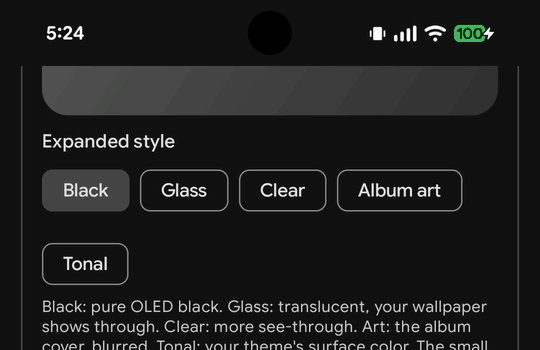
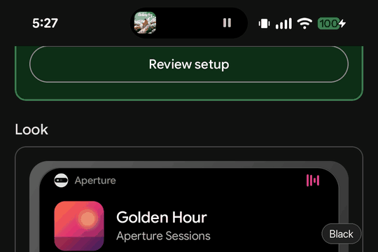
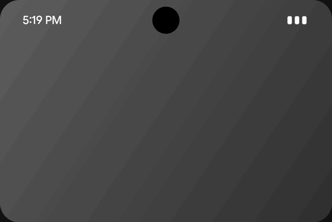
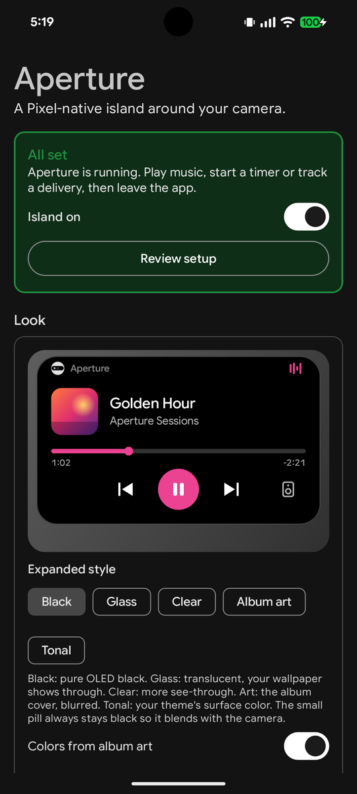
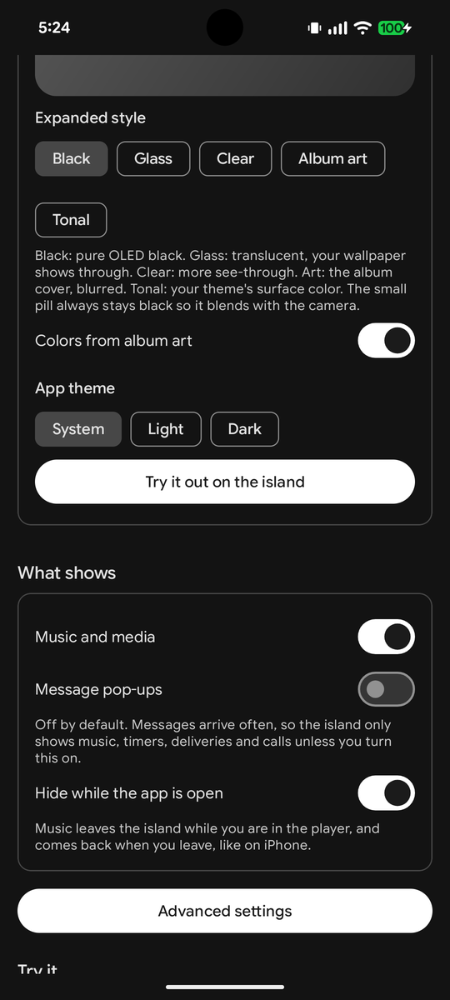
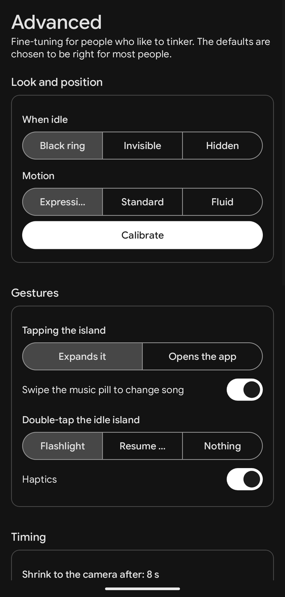
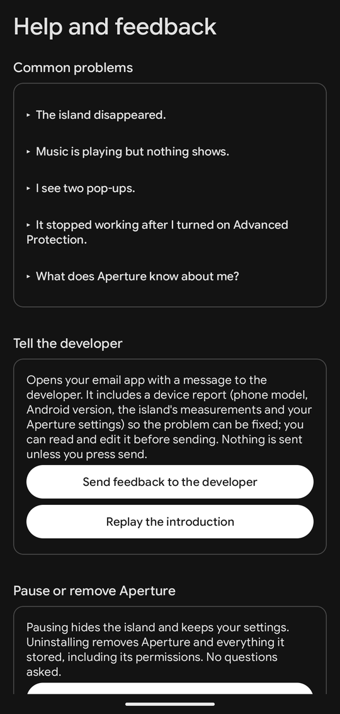
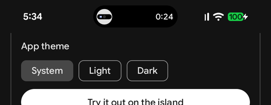
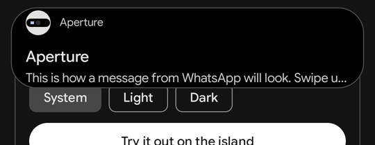

# Aperture

A Pixel-native dynamic island around your front camera. Free, no ads, no internet permission, written in Java.

<p align="center">
  
</p>

<p align="center"><sub>Recorded on a Pixel 8. Tap the island and it springs open into a full player, then folds back into a pill around the camera.</sub></p>

## Five looks for the expanded card

<p align="center">
  
</p>

**Black** is pure OLED black. **Glass** is translucent and lets the screen show through. **Clear** is more see-through still. **Album art** uses the blurred cover. **Tonal** uses your theme's surface color. The small pill always stays black so it blends with the camera.

## Preview it before you try it

The Look settings play a live, animated preview of the island in the style you pick. **Try it out on the island** then runs the same demo on the real island.

<p align="center">
  
</p>

## Screenshots

<table>
  <tr>
    <td></td>
    <td></td>
    <td></td>
    <td></td>
  </tr>
  <tr>
    <td align="center"><sub>Home</sub></td>
    <td align="center"><sub>Look</sub></td>
    <td align="center"><sub>Advanced</sub></td>
    <td align="center"><sub>Help and feedback</sub></td>
  </tr>
</table>

<p align="center">
  <br>
  
</p>

## What it does

- **Music and media:** YouTube Music, Spotify and any app with a media session. Album art, playing bars, progress with tap-to-seek, previous/play/next, the app's own custom action (like, thumbs up), and the system output picker. Swipe the pill sideways to change song.
- **Calls:** WhatsApp and phone calls with answer, decline and hang up, plus a call timer.
- **Live Updates:** timers and stopwatches, deliveries and rides, downloads.
- **Messages (optional):** WhatsApp, Messages, Gmail and others, with inline reply when the app supports it.
- **System (optional):** charging and low battery.
- Follows your system colors (Material You, contrast, dark theme) live, with a Light, Dark or System theme for the app itself. Uses Google Sans Flex on Pixel.

## What shows on the island

Only the things worth a glance, and only from the apps you pick:

- **Music and media**, once you leave the player app. Nothing shows while the player is on screen.
- **Timers, stopwatches, deliveries, rides and downloads** (Live Updates).
- **Calls.**
- Off by default, because they arrive often: message pop-ups, and charging or low battery. Turn them on in the app.

## Screen care (OLED)

A pill that stays on screen for hours wears the OLED around it unevenly. So after a few seconds without change (8 s by default, adjustable), the pill shrinks back to a ring around the camera. While something is live, like a playing song or a running timer, the ring shows it as a thin arc that moves every second; paused music leaves no ring at all. The compact content also shifts by 1 px each minute. On the lock screen the island only shows calls by default.

## Gestures

| Gesture | On | Does |
|---|---|---|
| Tap | pill or ring | expand (keeps you in your app) |
| Long-press | pill or ring | open the app |
| Tap | expanded card | open the app (buttons do their own thing) |
| Swipe down | pill | expand |
| Swipe up | card | collapse or dismiss |
| Swipe sideways | music pill | next or previous song |
| Swipe sideways | message card | dismiss the notification |
| Double-tap | idle ring | flashlight (or resume media, set in Advanced) |

Tap and long-press can be swapped in Advanced.

## Privacy

Aperture has no internet permission, so nothing can leave your phone. It never reads what is on your screen: the accessibility service only draws the island and watches which app is in front. Notifications are read on the phone to build the island and are never stored. Feedback opens your own email app with a report you can read and edit before sending. The full policy is in [PRIVACY.md](PRIVACY.md).

## Build

Requirements: the Android SDK and JDK 17 or newer. Android Studio's bundled JBR works.

```bash
JAVA_HOME="/Applications/Android Studio.app/Contents/jbr/Contents/Home" ./gradlew :core:test assembleDebug
```

The APK is `app/build/outputs/apk/debug/app-debug.apk`.

For the Play Store bundle (`./gradlew :app:bundleRelease`), signing, and every answer the Play Console asks for, see [docs/PLAY_STORE.md](docs/PLAY_STORE.md).

## Install and set up (Pixel)

```bash
adb install -r app/build/outputs/apk/debug/app-debug.apk
```

Open **Aperture** and follow the introduction. It explains what the island does and what it can see, then walks you through the two permissions (the accessibility island and notification access), lets you pick apps, and asks to keep Aperture running after a restart. You can pause or fully uninstall it any time from **Help, feedback and uninstall**.

Installing over adb avoids Android's "restricted settings" block. If you install the APK from a file manager instead, first go to App info > ⋮ > **Allow restricted settings**.

## Known limits

- **Android 17 Advanced Protection blocks the island.** Android turns off every accessibility service that isn't an accessibility tool. The app detects this and says so.
- **Fullscreen apps:** the island doesn't hide yet in fullscreen video. It does hide in camera apps and in landscape.
- **Duplicate pop-ups:** Android's own heads-up shows too. For apps you watch in the island, turn off Settings > Notifications > the app > Pop on screen.

## Project layout

| Path | What |
|---|---|
| `core/` | Pure Java: geometry (Section 7.2 and rules G1-G5), the island engine (priorities, queue, pinning, expiry), playback math. Unit-tested |
| `app/` | The Android app: overlay service and renderer, notification and media sources, settings screens |
| `docs/` | The [spec](docs/SPEC.md), [research and measurements](docs/RESEARCH.md), [decision records](docs/adr/README.md) and README media |
| `spikes/phase0-probe/` | Throwaway Phase 0 measuring app |
